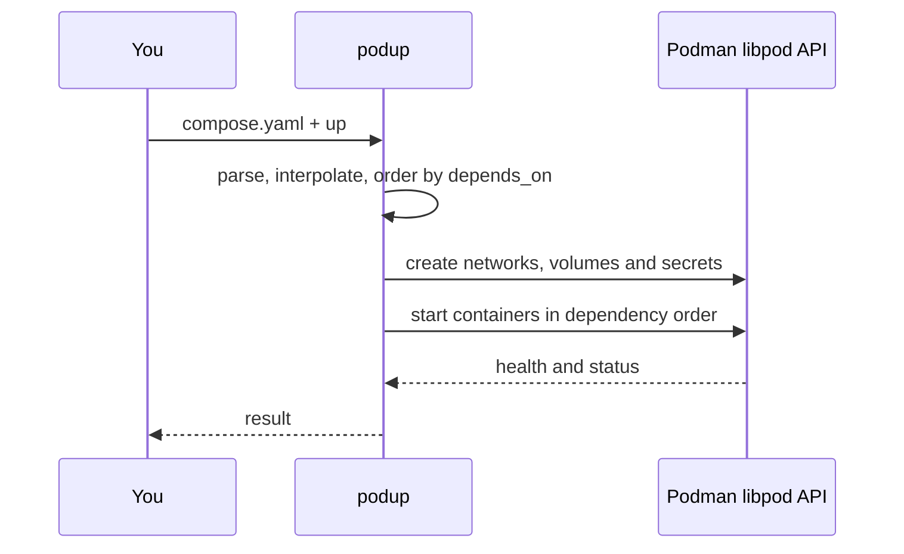

# podup

Run Compose projects on rootless Podman. podup reads your `compose.yaml` and
drives Podman through its native libpod API: one standalone binary with no
daemon of its own.

[](https://github.com/Glyndor/podup/actions/workflows/ci.yml)


## Features

- The Compose commands you know, with `depends_on` ordering and healthcheck conditions.
- `extends`, profiles, `include` and `develop.watch` file sync.
- Podman-native secrets and configs, including inline `content:`.
- systemd integration: export a project as Quadlet units, or start it at boot with `podup autostart install`.
- `podup audit` flags risky settings in a Compose file before you run it.

## Install

podup needs **Podman 6.2.0 or newer**, reached through a local socket. Podman 5
and older are not supported: podup refuses to work with an older engine. It runs
on Linux, macOS and Windows (x86_64 and arm64).

Current Debian and Ubuntu releases ship an older Podman of their own. The apt
repository below carries Podman 6.2.0 for Debian 13 and Ubuntu 24.04 and 26.04,
and installing podup from it installs that Podman too; see
[Platforms](docs/docker-migration.md#platforms).

```sh
curl -fsSL https://apt.glyndor.net/install/podup | sudo sh
```

On Debian and Ubuntu this adds the signed Glyndor apt repository and installs
podup as a package, so `apt upgrade` keeps it current. A minimal image or
container has neither `curl` nor `sudo`: run
`apt-get update && apt-get install -y ca-certificates curl` first, and leave
`sudo` out of the line above when you are already root. Check the result with
`podup --version`.

<details>
<summary><b>Optional: macOS, Windows and other Linux distributions</b></summary>

**macOS** (with a running `podman machine`):

```sh
brew install glyndor/tap/podup
```

**Windows** (with a running `podman machine`; Scoop needs git):

```powershell
scoop bucket add glyndor https://github.com/Glyndor/scoop-bucket
scoop install podup
```

The Windows binary is not Authenticode-signed, so a host with Smart App Control
enabled can block it. [Migrating from Compose](docs/docker-migration.md#windows)
describes running the Linux binary inside `podman-machine-default` instead.

**Other Linux distributions** (needs `curl`, `sha256sum`, Python 3 with
`cryptography` to verify the download, a local Podman 6.2.0 or newer, and write
access or `sudo` for `/usr/local/bin`):

```sh
curl -fsSL https://glyndor.net/podup/install/unix | bash
```

This installs the release binary to `/usr/local/bin`; `podup update` keeps it
current.

</details>

### Verify what you installed

- **apt:** the installer checks the archive key against the fingerprint
  published in the [apt repository](https://github.com/Glyndor/apt#verify-the-signing-key),
  a second place that does not depend on the website, and apt verifies every
  package signature.
- **Homebrew and Scoop:** each checksum comes from a `SHA256SUMS` verified
  against the organization's Ed25519 release key before it is published.
- **The installer script and `podup update`:** both verify an Ed25519 signature
  over `SHA256SUMS`, then the binary's digest, with a key built in.

[Self-update](docs/self-update.md) has the full chain and how to check a release
by hand.

## Quick start

On Linux with a systemd user session, enable the rootless Podman API socket once:

```sh
systemctl --user enable --now podman.socket
```

Then, in a directory with a Compose file:

```sh
podup up -d      # start the stack
podup ps         # list its containers
podup down       # remove containers and networks; volumes are kept
```

`podup down -v` also removes the project's named volumes and their data.

## What `podup up` does



Compose files are trusted input: review their host mounts and commands before
running them.

## Documentation

| Guide | What it covers |
|---|---|
| [Commands](docs/commands.md) | Commands, options and environment settings |
| [Migrating from Compose](docs/docker-migration.md) | Supported fields, differences, platforms |
| [Autostart](docs/autostart.md) | Starting a project at boot, Quadlet export |
| [Security model](docs/security-model.md) and [threat model](docs/threat-model.md) | What podup protects and what it assumes |
| [Self-update](docs/self-update.md) | How `podup update` verifies a release |
| [Debian packaging](docs/debian-packaging.md) | The apt package and its update policy |
| [Benchmarks](docs/benchmarks.md) | Memory and latency against docker-compose and podman-compose, measured on podup 5.10.8 and Podman 5.7.0 (below the 6.2.0 floor podup now requires), with method and limits |
| [Contributing](CONTRIBUTING.md) | Building from source and the contribution flow |

## License

[MIT](LICENSE). Report vulnerabilities privately through the **Security** tab,
never in a public issue.
